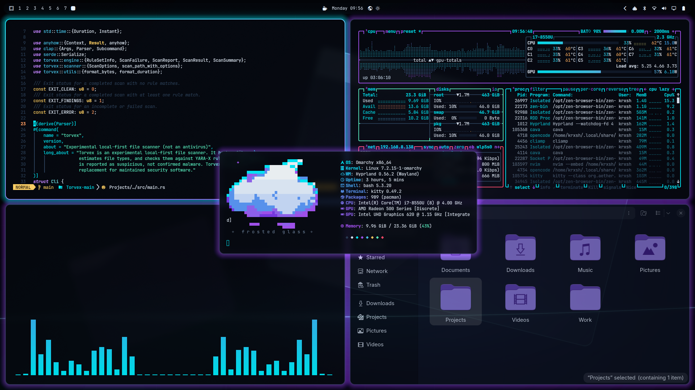

# Aether

**Cyber-ethereal frosted glass for Omarchy.** Deep midnight and obsidian surfaces,
electric cyan, neon violet, and glass that stays readable.



Aether is a complete local Omarchy theme: it themes the compositor, the shell,
the lock card, terminals, btop, Helix, Chromium and GTK, and it ships three
wallpapers plus a Plymouth wordmark. It also carries a **fastfetch emblem** — a
pixel cloud lit cyan at its hump and shading violet at its base — that replaces
`fastfetch` output and, through the extras About override, the Omarchy menu's
About panel, and it retints the
CLI tools Omarchy does not cover natively (cava, lazygit) through a theme hook.
The palette is defined once in `colors.toml`; Omarchy renders Neovim, VS Code,
tmux, fzf, gum, Obsidian and the rest from that file when the theme is applied.

---

## Design

| Role | Colour |
| --- | --- |
| Background / obsidian | `#070b14` |
| Deepest surface | `#020309` |
| Raised surface | `#111a2b` |
| Foreground | `#e6f1ff` |
| Electric cyan | `#00f0ff` |
| Neon violet | `#a855f7` |
| Mint (success) | `#5cf2c5` |
| Amber (warning) | `#ffd166` |
| Coral (error) | `#ff4d6d` |
| Signal blue | `#4cc9f0` |

The signature border is a cyan → violet gradient at 45°. Terminals sit at
**0.72 opacity** over Hyprland's frosted blur; shell cards range from 0.55 to
0.90 depending on how much text they carry. Glass is only visible over a
luminous backdrop — keep the `1-aether-veil` wallpaper active (see
[Wallpapers](#wallpapers)).

## Requirements

- Omarchy 3.x with the Lua theme API (tested on Hyprland 0.56.2).
- JetBrainsMono Nerd Font for terminal and btop glyphs (Omarchy installs it).
- Optional, only for rebuilding art: ImageMagick 7 and `rsvg-convert`.

No extra packages are needed to apply the theme.

## Install and apply

```bash
# Copy the whole folder into the user theme directory
mkdir -p ~/.config/omarchy/themes
cp -r aether ~/.config/omarchy/themes/

# Apply it
omarchy theme set aether
```

`omarchy theme list` should show **Aether**. The first switch stages the theme,
renders every template, and retints the running shell; give it a few seconds.

To go back, apply any other theme from `omarchy theme switcher` or
`omarchy theme list`.

## What is in the package

| File | Purpose |
| --- | --- |
| `colors.toml` | Single source of truth for the palette and ANSI table |
| `hyprland.lua` | Border gradient, compositor blur, shadows, group bar, layer-shell blur |
| `kitty.conf`, `alacritty.toml`, `foot.ini`, `ghostty.conf` | Terminal palettes at 0.72 opacity |
| `btop.theme` | Transparent btop theme using the terminal's glass |
| `helix.toml` | Helix syntax and UI theme with a transparent editor background |
| `shell.bar.toml` | Bar surface, sizing and active-workspace colour |
| `shell.controls.toml` | Shared focus, hover, selected and pressed states |
| `shell.popups.toml` | Bar flyouts, dropdowns and OSD cards |
| `shell.notifications.toml` | Notification cards and countdown accent |
| `shell.launcher.toml` | Launcher overlay, scrim and selection |
| `shell.menu.toml` | Menu, clipboard and emoji cards |
| `shell.polkit.toml` | Authentication prompt |
| `shell.tooltip.toml` | Hover tooltips |
| `shell.image-picker.toml` | Wallpaper and theme picker borders |
| `shell.lock.toml` | Lock-screen password card |
| `shell.hyprland.toml` | Keeps `active-border-foreground` readable when the border is a gradient |
| `chromium.theme` | Browser UI tint (`7,11,20`) |
| `icons.theme` | Icon theme (`Yaru-purple`) |
| `fastfetch.jsonc` | The emblem: pixel cloud + themed module keys (keeps the user@host line) |
| `extras/about/` | The About panel: same emblem, no user@host, plus its launcher |
| `extras/bar/` | The floating bar: patched clone of Omarchy's bar engine, hook-gated |
| `obsidian.css` | Obsidian vault theme (synced to every vault by `omarchy-theme-set-obsidian`) |
| `fcitx5-theme.conf` | Input-method candidate window palette |
| `claude.json` | Claude Code theme (`custom:omarchy`) |
| `pi.json` | Pi coding-agent theme (`omarchy-system`) |
| `hermes.yaml` | Hermes skin (`omarchy`) |
| `backgrounds/` | Three 5120×2880 wallpapers plus the Omarchy wordmark wallpaper |
| `unlock.png` | 800×188 Plymouth boot wordmark (transparent) |
| `preview.png` | 2560×1440 theme-picker preview |
| `preview-unlock.png` | 1920×1080 Plymouth preview |
| `extras/` | Optional GTK palette, screensaver wordmark, CLI retint hook, asset generator |

## What changes with the theme: every CLI surface

Everything below switches automatically with `omarchy theme set aether` — the
first group is Omarchy's own pipeline, the second is Aether's theme hook
(`extras/omarchy-cli-retints`, installed with the other extras).

| Surface | How it switches |
| --- | --- |
| kitty / Alacritty / foot / Ghostty | Theme's own configs, staged verbatim, 0.72 glass |
| tmux | Env + `window-style` + OSC palette broadcast (`omarchy-theme-set-tmux`) |
| btop, Helix | Theme's `btop.theme` / `helix.toml`, hot-reloaded |
| gum menus, launcher, lock, polkit, OSD | `shell.*.toml` sections |
| Neovim | `omacom/aether.nvim` rendered from `colors.toml` |
| VS Code | `vscode-theme.json` generated from `colors.toml` |
| Obsidian | Theme's `obsidian.css` synced into every vault's "Omarchy" theme |
| fcitx5 | Theme's `fcitx5-theme.conf` synced to the "omarchy" candidate theme |
| Claude Code | Theme's `claude.json` synced to `~/.claude/themes/omarchy.json` |
| Pi | Theme's `pi.json` synced to `~/.pi/agent/themes/omarchy-system.json` |
| Hermes | Theme's `hermes.yaml` synced as the "omarchy" skin |
| Chromium / Brave / Chrome / Edge | `chromium.theme` browser retint |
| Keyboard RGB | `omarchy-theme-set-keyboard` from `colors.toml` |
| **fastfetch** | Theme hook: emblem config → `~/.config/fastfetch/config.jsonc` (keeps user@host) |
| **About panel** | Extras: cloud emblem config + launcher, wired into the menu's About action (no user@host) |
| **cava** | Theme hook: palette → `themes/omarchy-current` |
| **lazygit** | Theme hook: colours → `~/.config/lazygit/config.yml` |
| **Screensaver** | Theme hook: the Aether wordmark while Aether is active, your previous art otherwise |

Notes:

- fastfetch has no built-in Omarchy consumer, so the theme hook installs the
  emblem config as the user fastfetch config. That output keeps the
  `user@host` title line. The About panel is handled separately by the
  `about` extra: `install-extras.sh about` copies a dedicated config and
  launcher into `~/.config/omarchy/branding/` and re-points the menu's
  About action at them via a one-key override in
  `~/.config/omarchy/extensions/omarchy-menu.jsonc` (the extension template's
  own documented pattern). The result: the same pixel-cloud emblem, no
  `user@host` line, and a window sized by the launcher's own rule instead of
  Omarchy's measured-fit pipeline. The panel stays open until closed with the
  window-close keybind (a session script holds the window the way
  omarchy-launch-about's render loop does). The panel carries its own app-id
  (`org.aether.about`) so its focus chain never grabs — or gets grabbed by —
  the stock panel's window: an About opened from the launcher is always the
  Aether panel, and the stock pipeline's measured-fit sizing is never
  shadowed. The override is **Aether-only**: under any other theme the
  launcher delegates to the stock
  `omarchy-launch-about` — other themes keep their own About panel untouched —
  and it falls back to the stock panel too if Aether's files are missing.
  `install-extras.sh --remove` restores the stock About action; deleting
  `~/.config/fastfetch/config.jsonc` returns fastfetch to Omarchy's stock
  output (the About panel is independent of that file).
- Claude Code, Pi and fcitx5 only *use* the synced file once their own theme is
  pointed at `omarchy` — `install-extras.sh` does that activation for you
  (backing up your settings first); the theme-set pipeline keeps the colours in
  step from then on.
- The shell prompt (starship) already follows the terminal palette because it
  styles itself with named ANSI colours, which every terminal takes from
  `colors.toml`.

## Glass, blur and opacity

The theme bakes glass into the theme itself, so it does not depend on the
optional appearance toggles:

- Hyprland blurs transparent windows and Omarchy's layer-shell surfaces through
  `hyprland.lua`.
- Each terminal carries its own opacity, so its text does not fade with a
  window-rule opacity.
- The shell cards set their own alpha in `shell.*.toml`.
- Nautilus fades to `0.82 / 0.78`, and Obsidian joins it at `0.90 / 0.86`
  (the glass extension pack in `hyprland.lua`). Further lines there are
  commented and ready for Spotify, Discord, VS Code, Steam or Postman.

If you want the stronger global treatment Omarchy offers:

```bash
omarchy hyprland window transparency glassy   # glassier windows, including GTK
omarchy bar background glassy                 # glassier bar
```

Those toggles are optional. Turning them off leaves Aether's baked-in glass
intact. With the bar extra installed (see *Optional extras*), Aether already
ships the glassy bar background through its hook, and cycles or explicit
settings win while another theme is active.

To adjust the terminal glass, edit the opacity line in each terminal file and
re-apply the theme:

| Terminal | Key |
| --- | --- |
| kitty | `background_opacity 0.72` |
| Alacritty | `opacity = 0.72` under `[window]` |
| foot | `alpha=0.72` under `[colors-dark]` |
| Ghostty | `background-opacity = 0.72` |

The default `0.72` is deliberately see-through; near `0.88` is more opaque.

## Lock screen, boot screen and screensaver

These are three different surfaces, and Aether treats them separately:

- **Lock screen** — Omarchy's Quickshell lock uses the current wallpaper
  (blurred by the lock view) and the card styled by `shell.lock.toml`. Preview
  it with `omarchy system lock`; the display turns off, so wake it to inspect
  the card.
- **Boot / Plymouth** — `unlock.png` is the 800×188 transparent wordmark shown
  by Plymouth during boot. It is **not** the lock-screen background. Install it
  as the boot logo with:

  ```bash
  omarchy plymouth set by theme aether
  ```

  That command needs sudo. Inspect it first without touching the boot theme:

  ```bash
  omarchy plymouth preview '#070b14' '#e6f1ff' \
    ~/.config/omarchy/themes/aether/unlock.png /tmp/aether-plymouth.png
  ```

  `omarchy plymouth reset` restores the stock boot screen.

- **Screensaver** — the TTE terminal animation reads
  `~/.config/omarchy/branding/screensaver.txt`. The core theme does not
  overwrite that user file; install the Aether wordmark from `extras/`:

  ```bash
  ~/.config/omarchy/themes/aether/extras/install-extras.sh screensaver
  omarchy screensaver   # preview
  ```

  Once the hook is installed, the wordmark also **follows theme switches**:
  it is the screensaver while Aether is active, and any other theme gets your
  previous art back (the copy the installer backed up — or the stock Omarchy
  logo when there is no record). `omarchy branding screensaver reset` returns
  to the stock art; the hook re-asserts Aether's wordmark on the next switch.

## Wallpapers

`backgrounds/` contains:

1. `1-aether-veil.webp` — the glass hero: a luminous aurora sheet, cyan
   energy ribbon and three floating glass panes. Mean luminance ~48/255,
   tuned so Hyprland's blur has real light to refract.
2. `2-aether-obsidian.webp` — violet monolith over a low cyan horizon
   (mean ~17 — moody, but frosted glass is barely visible over it).
3. `3-aether-horizon.webp` — aurora horizon and a perspective grid floor
   (mean ~13 — same caveat).
4. `omarchy.webp` — minimal Aether wordmark wallpaper (3840×2160).

Glass visibility is a function of wallpaper luminosity: a near-black
wallpaper makes any opacity read as plain black. Keep the veil active for
the intended frosted look.

Cycle them with `omarchy theme bg next`, or open the picker with
`omarchy theme bg-switcher`. User-added backgrounds belong in
`~/.config/omarchy/backgrounds/aether/` and are kept separately from the theme
package.

## Preview metadata

Omarchy's theme picker reads these files by convention from the theme folder:

| File | Size | Used for |
| --- | --- | --- |
| `preview.png` | 2560×1440 | Theme-picker desktop card |
| `preview-unlock.png` | 1920×1080 | Plymouth preview card |
| `unlock.png` | 800×188 | Actual Plymouth boot logo |

There is no separate layout manifest: the folder name is the theme name, and
the three images above plus `backgrounds/` are the metadata. Keep the exact
filenames if you repackage the theme.

After changing the palette or wallpapers, rebuild the art with:

```bash
~/.config/omarchy/themes/aether/extras/generate-assets.sh
```

The generator composes at 2560×1440, upscales wallpapers to 5120×2880, and
rewrites `unlock.png`, both previews and `backgrounds/omarchy.webp` in place.

## Optional extras

Install everything optional (GTK palette, screensaver wordmark, fastfetch
emblem, floating bar, cava/lazygit retints, hook, and the agent-theme
activations):

```bash
~/.config/omarchy/themes/aether/extras/install-extras.sh
```

The installer backs up every file it touches (records kept in
`~/.local/state/omarchy/aether-cli/` and next to the GTK files), injects its GTK
changes inside removable marker blocks, and installs the theme hook into
`~/.config/omarchy/hooks/theme-set.d/50-aether-cli-retints` so fastfetch, cava,
lazygit, the bar and the screensaver follow **every** theme switch, not just
Aether's:

```bash
# Single pieces
.../install-extras.sh gtk
.../install-extras.sh screensaver
.../install-extras.sh about
.../install-extras.sh bar
.../install-extras.sh fastfetch
.../install-extras.sh cava
.../install-extras.sh claude
.../install-extras.sh fcitx5

# Undo everything the installer recorded
.../install-extras.sh --remove
```

The GTK4 file defines libadwaita's named colours; the GTK3 file defines the
older `theme_*` tokens. Neither replaces Adwaita's widget layout. Backdrop blur
in GTK apps still comes from Omarchy's Glassy windows mode. See
[`extras/README.md`](extras/README.md) for details.

The `bar` extra installs the floating bar: a patched clone of Omarchy's bar
engine (made with `omarchy plugin clone omarchy.bar`) whose strip sits inset
from the screen edge with fully rounded ends, instead of hugging it full-width.
The clone is a full copy of the engine, so it renders from the Omarchy version
present when the theme shipped and lags upstream bar changes until the theme
re-ships it. The hook only flips `bar.id` (the clone while a theme that ships
`extras/bar` is active, the stock engine otherwise) and `bar.background`
(glassy while Aether is active; on leaving, the background you had before
Aether ever took over, recorded at that first switch). Your widget layout is
never touched. A pre-existing clone of your own is backed up whole and
restored by `--remove`. Theme content changes are staged on
`omarchy theme set`, so after adding or changing theme files, re-run
`omarchy theme set aether` before the hook sees them.

The same hook heals the terminals: their configs are includes of the staged
theme's files, so palette and opacity already follow every switch, and a
last-in-line reload re-resolves them for any terminal whose reload raced the
theme swap (back-to-back switches can land a reload while the theme directory
is being replaced — kitty keeps its previous look in that case).

## Customizing

1. **Palette** — edit `colors.toml`, then run `omarchy theme set aether`. Omarchy
   re-renders Neovim, VS Code, tmux, fzf, gum, Obsidian, Chromium policy and the
   other generated app themes from it.
2. **Compositor feel** — edit `hyprland.lua` for rounding, gaps, blur strength,
   shadow colour or the border angle. Your own `~/.config/hypr/looknfeel.lua`
   still loads after the theme and wins.
3. **Shell surfaces** — edit the relevant `shell.*.toml`. These files replace
   whole generated sections, so keep every key that the stock section defines.
4. **Terminals, btop, Helix** — edit their files directly. Local user themes keep
   these files verbatim.
5. **The fastfetch emblem** — edit `fastfetch.jsonc` (art is the inline
   `"data-raw"` logo string). Re-apply the theme or run
   `~/.config/omarchy/hooks/theme-set.d/50-aether-cli-retints fastfetch` to
   reinstall it.
6. **Glass on more apps** — uncomment a window rule in the "Glass extension
   pack" block of `hyprland.lua` and re-apply the theme.

## Distribution caveat

Omarchy trusts a theme in `~/.config/omarchy/themes/` that is a plain folder
more than one installed from a git repository. A git-installed theme is treated
as untrusted: its terminal configs (`kitty.conf`, `alacritty.toml`, `foot.ini`,
`ghostty.conf`) and `vscode.json` are not staged, and Omarchy regenerates the
terminal themes from `colors.toml` instead. The hand-tuned 0.72 opacity may
then be replaced by your Glassy settings.

If you distribute Aether through git and want the shipped terminal files used
verbatim, install it by copying the folder into
`~/.config/omarchy/themes/aether` rather than using `omarchy theme install`.

## File layout

```text
aether/
├── README.md
├── LICENSE
├── colors.toml
├── hyprland.lua
├── kitty.conf
├── alacritty.toml
├── foot.ini
├── ghostty.conf
├── btop.theme
├── helix.toml
├── chromium.theme
├── icons.theme
├── fastfetch.jsonc
├── obsidian.css
├── fcitx5-theme.conf
├── claude.json
├── pi.json
├── hermes.yaml
├── shell.bar.toml
├── shell.controls.toml
├── shell.hyprland.toml
├── shell.image-picker.toml
├── shell.launcher.toml
├── shell.lock.toml
├── shell.menu.toml
├── shell.notifications.toml
├── shell.polkit.toml
├── shell.popups.toml
├── shell.tooltip.toml
├── unlock.png
├── preview.png
├── preview-unlock.png
├── backgrounds/
│   ├── 1-aether-veil.webp
│   ├── 2-aether-obsidian.webp
│   ├── 3-aether-horizon.webp
│   └── omarchy.webp
└── extras/
    ├── README.md
    ├── generate-assets.sh
    ├── install-extras.sh
    ├── omarchy-cli-retints
    ├── gtk.aether.css
    ├── gtk3.aether.css
    ├── screensaver.txt
    ├── preview.svg
    └── src/
        ├── pane1.png
        ├── pane2.png
        └── pane3.png
```

## Credits and license

Built for [Omarchy](https://omarchy.org) and its native theme pipeline. Aether
does not modify `/usr/share/omarchy/` or any system file; everything lives in
the theme folder or, for the optional extras, in your user configuration.

Theme configuration and generated artwork are released under the MIT License;
see [`LICENSE`](LICENSE). Wallpapers and the Aether wordmark are original work
created for this theme.
